# AI4S Two-Pass ViT Agent

**English** · [简体中文](README_zh.md)

Physics-informed, multi-modal **dataset quality inspection** agent for space-science imagery and magnetometer time series. Combines deterministic metrics with a **two-pass** vision / text LLM workflow, plus an optional **Dataset Router** and **Scientific Debater** extension track.

> **Privacy:** This repository contains **code, docs, and a few downsampled gallery crops only**. No full competition datasets, partner-identifying materials, or credentials.

---

## At a glance

| | |
|---|---|
| **Background** | OPC-style QC on **AIA (solar EUV)**, **EPB (airglow)**, **ULF (magnetometer)**, and extended instrument families (e.g. aurora UV, coronagraph). Pure end-to-end VLMs suffer hallucinations on diffuse targets and 1D waveforms. |
| **Method** | Local **physics / geometry operators** → **Pass 1** perception → script-audited metrics → **Pass 2** grounded verdict (must cite numbers). **Router** profiles unknown dirs; **Debater** drafts `auxiliary_metrics.py` in a sandbox for new families. |
| **Innovations** | Dual-track gate (frozen benchmark IDs → rule-only); gated **Teaching**; tiered **Memory**; AST **code sandbox** for model-written helpers; reproducible Docker + smoke harness. |
| **Results** | Full object-level QC + scoring on official benchmark dirs; **6 instrument families / 30 public subsets — 100% router accuracy** in regression harness; offline Debater E2E on EPB / DMSP / CME samples; `linux/amd64` container. |

---

## Architecture

### 1) Entry: `run_pipeline.py` (benchmark vs extension)

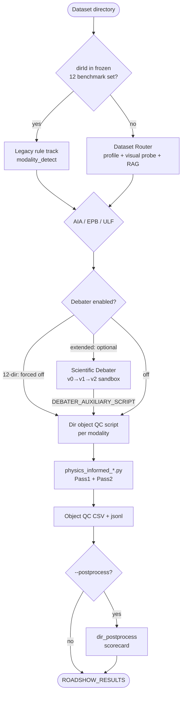

### 2) Per-sample two-pass (rules first, LLM grounds on numbers)

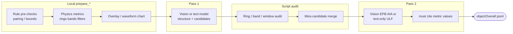

| Modality | Pass 1 input | Metrics (examples) | Pass 2 model |
|----------|----------------|-------------------|--------------|
| **AIA** | EUV + JSON overlay | ring contrast Δ, missed bright candidates | Vision |
| **EPB** | Airglow + mask overlay | band depletion σ, area vs median | Vision |
| **ULF** | Band-pass + Hilbert plot (no image to Pass 2) | Pi2 window SNR, energy ratio | **Text only** |

### 3) ULF pipeline detail (same pattern as diagram above)

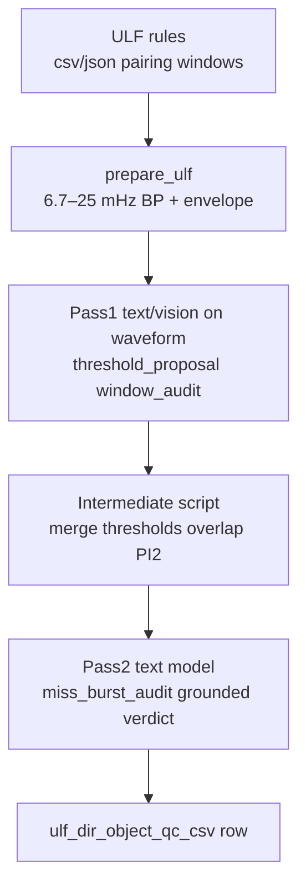

### 4) Extension: Debater → main track (env-gated)

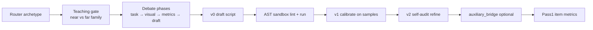

Legend: **solid** = deterministic Python; **dashed policy** = LLM only when secrets mounted; benchmark dirs **never** attach Debater output to scoring path.

---

## vs typical “LLM Agent” stacks

| Typical pattern (CrewAI / ReAct / tool-calling chat) | This project |
|------------------------------------------------------|--------------|
| Open-ended **ReAct** loop: model picks tools until stop | **Fixed DAG**: rule scripts → Pass1 → metric audit → Pass2; optional Debater is a **side branch** |
| **Multi-agent** roles negotiate in chat | **Single orchestrator** (`run_pipeline.py`) + phase-structured **Debater** (deliverables per stage) |
| Long **vector memory** across sessions | **Run-local memory** for benchmarks; Debater uses **phase-trimmed context** (no cross-run leakage) |
| Model **computes or guesses** numbers in prose | Numbers come from **Python physics ops**; Pass2 must **quote** them (ULF Pass2 is **text-only**, no waveform image) |
| **Function calling** to HTTP/DB tools | “Tools” are **batch QC scripts**; extension track adds **sandboxed code generation** (`auxiliary_metrics`) |
| One-shot or CoT prompt for QC | **Two-pass** with mandatory intermediate jsonl + **nine-defect** CSV schema |
| LangGraph everywhere | LangGraph in **`graph.py`** (record-level rules); main roadshow path is **subprocess pipeline** for reproducibility |

**Takeaway:** closer to **agent harness + domain workflow** than a general conversational agent—the LLM is a **grounded judge / code drafter**, not the score owner.

---

## Safety & trust (model + code)

| Layer | What we enforce |
|-------|------------------|
| **Anti-hallucination** | Pass2 prompts require cited scalars; ULF decouples waveform **DSP in Python** from Pass2 **text** reasoning |
| **Benchmark integrity** | Frozen **12 dir IDs** → rule-only track, Debater **disabled**, no auxiliary injection on the scoring path |
| **LLM-generated code** | `script_sandbox.py`: AST allow-list imports, blocked `exec/eval/__import__`, read-only `open`, JSON-serializable returns only |
| **Auxiliary scope** | `auxiliary_bridge` only runs when `DEBATER_AUXILIARY_SCRIPT` is set; does **not** replace `objectOverall` QC |
| **Teaching safety** | `do_not_copy_when` downgrades prompts for **far** instrument families to avoid cross-domain copy-paste |
| **Supply chain** | No secrets in repo; `secrets.yaml` mount optional; offline Debater / smoke paths need **no API** |
| **Regression** | `smoke_test` fingerprints + `verify_extended_pipeline` + `check_pipeline_completeness` |

---

## Gallery

### Demo keyframes (from workflow videos)

Frames extracted from [`agent_workflow_demo.mp4`](docs/media/agent_workflow_demo.mp4) and [`ulf_signal_pipeline_demo.mp4`](docs/media/ulf_signal_pipeline_demo.mp4)—**not** marketing covers.

| AIA two-pass UI | EPB two-pass UI | ULF filter / Pass2 track |
|:---:|:---:|:---:|
| 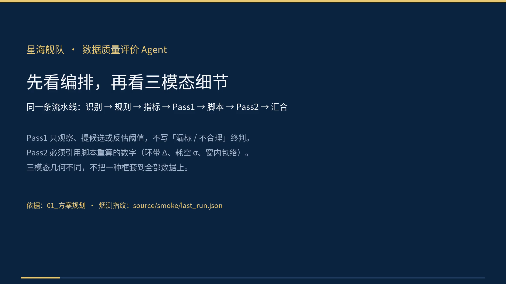 | 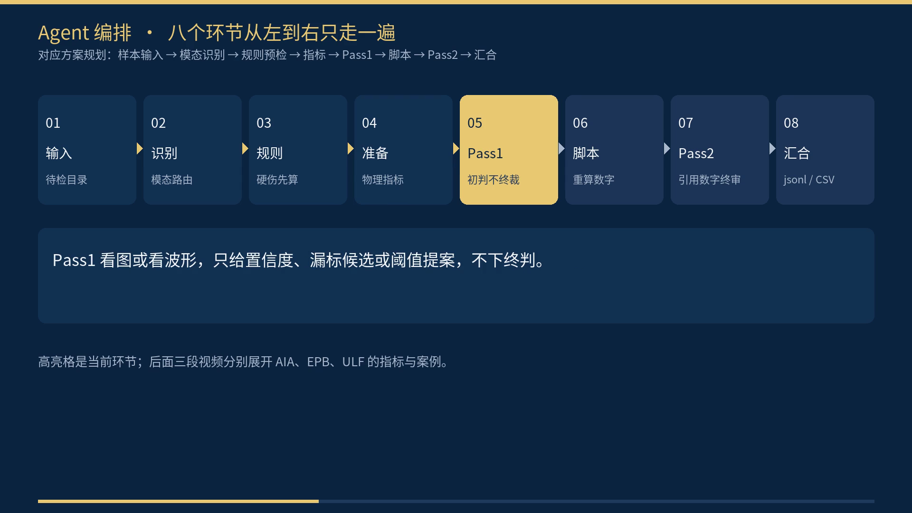 | 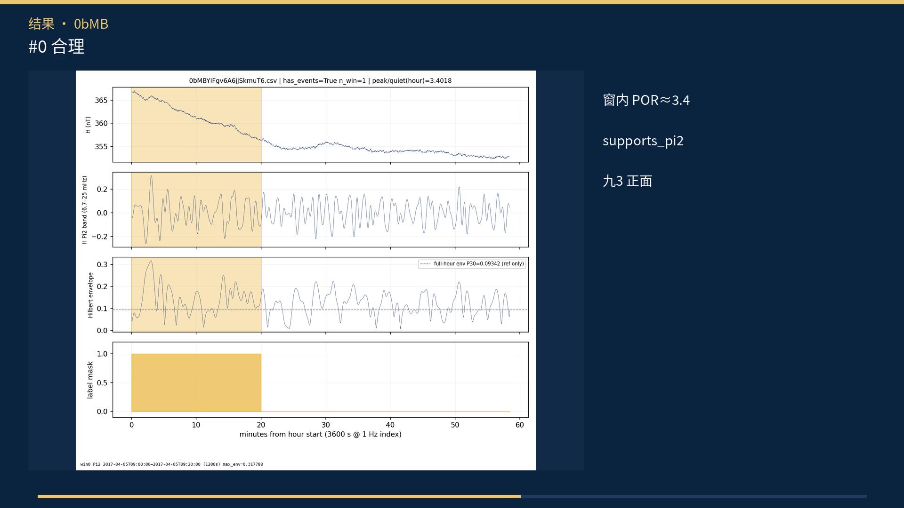 |

### Modality summary posters (covers only)

| AIA solar EUV | EPB airglow | ULF Pi2 waveform |
|:---:|:---:|:---:|
| 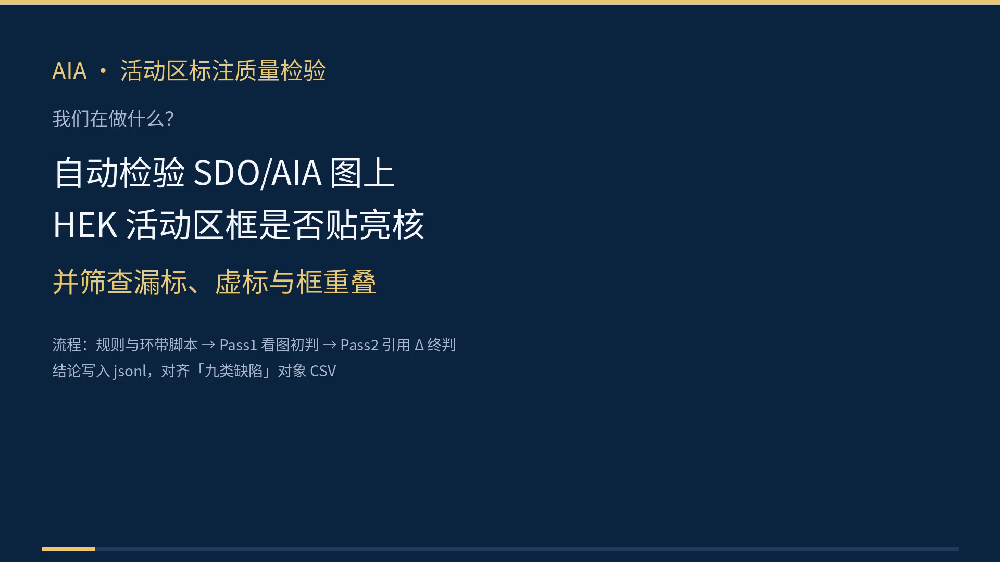 |  |  |

### Extension track (single-frame examples)

| EPB overlay QC | DMSP aurora UV | CME coronagraph | AIA AR (resized) |
|:---:|:---:|:---:|:---:|
| 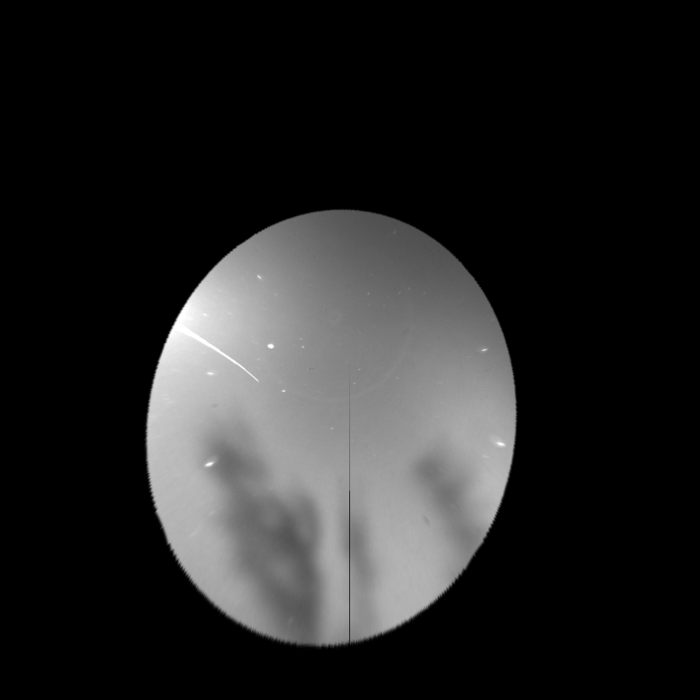 | 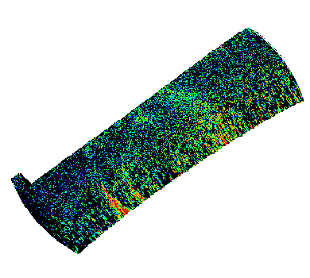 | 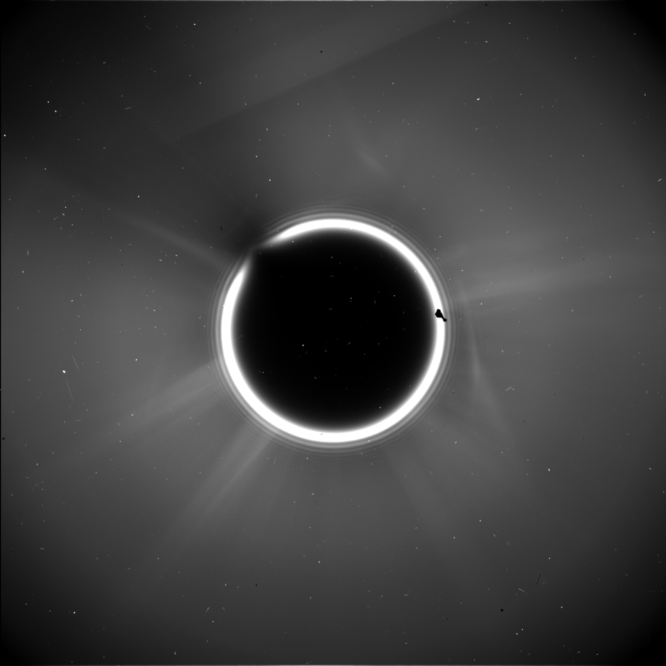 | 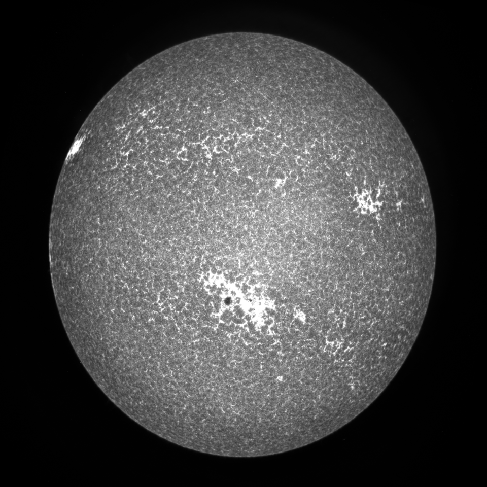 |

See [docs/gallery/README.md](docs/gallery/README.md).

---

## Demos (short clips)

| Clip | Content |
|------|---------|
| [agent_workflow_demo.mp4](docs/media/agent_workflow_demo.mp4) | End-to-end agent workflow overview |
| [ulf_signal_pipeline_demo.mp4](docs/media/ulf_signal_pipeline_demo.mp4) | ULF band-pass / envelope / Pass 2 text track |

---

## Quick start

```bash
docker build --platform linux/amd64 -f docker/Dockerfile -t space-science-agent:latest .
# Mount your data root at /data and optional secrets.yaml
docker run --rm -v /path/to/data:/data:ro -e ROADSHOW_DATA=/data \
  space-science-agent:latest smoke/smoke_test.py
```

```bash
python3 smoke/check_pipeline_completeness.py
python3 smoke/verify_extended_pipeline.py   # needs ROADSHOW_REPO_ROOT with public sample dirs
python3 agent/run_pipeline.py --dir /path/to/dataset --limit 5 --router auto --debater offline
```

Environment: `ROADSHOW_DATA`, `ROADSHOW_RESULTS`, `AGENT_PIPELINE_ROOT`, optional `secrets.yaml` for Pass 1/2 API.

---

## Repository layout

| Path | Role |
|------|------|
| `package/agent_modules/` | Physics metrics, QC, `dataset_router`, `scientific_debater` |
| `package/scripts/` | Dir/object CSV pipelines, postprocess |
| `agent/` | `run_pipeline.py`, agent YAML |
| `smoke/` | `smoke_test`, `verify_extended_pipeline`, completeness check |
| `docker/` | `linux/amd64` image |
| `docs/` | Defect specs, gallery, media |

---

## Citation & license

Research / competition codebase. If you use this work, cite the repository URL. Dataset terms remain with original OPC / instrument providers—**do not redistribute** roadshow archives via this repo.

---

## Contact

Issues and discussions: [GitHub Issues](https://github.com/Rayana-AD/AI4S-TwoPassViT-Agent/issues).