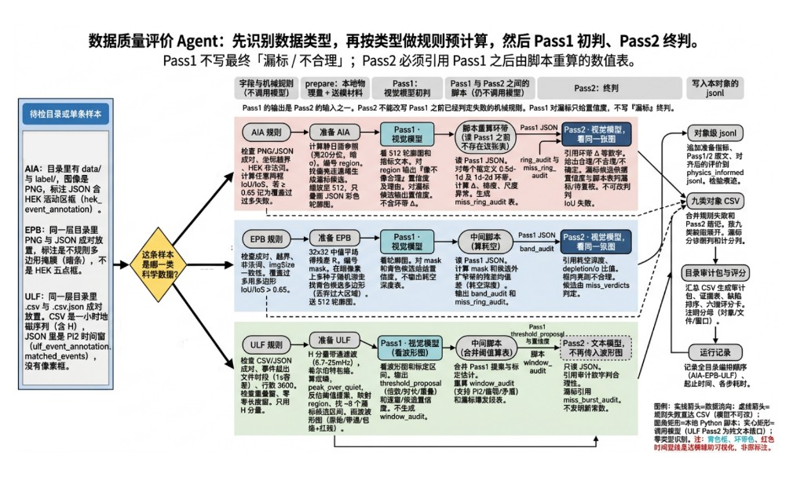
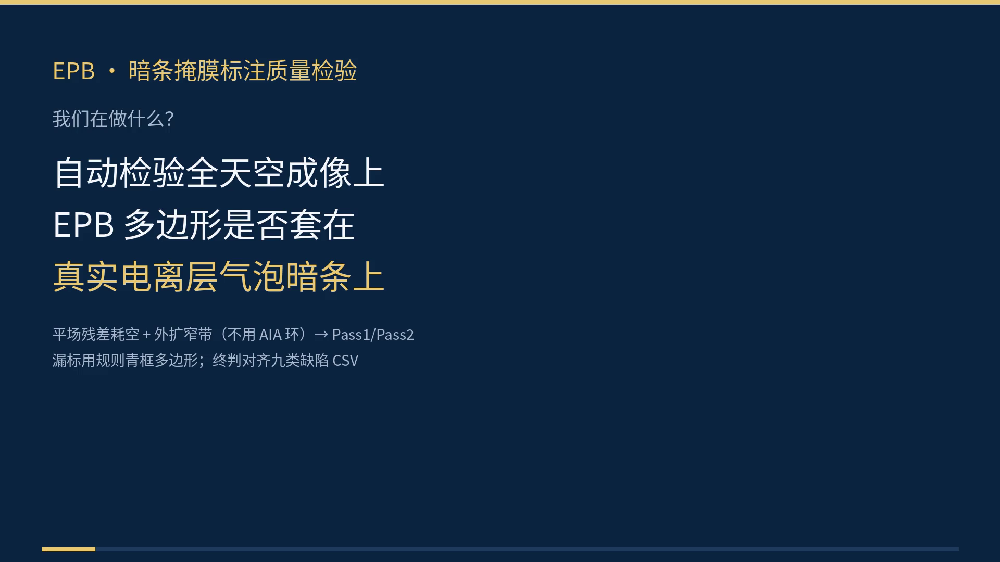
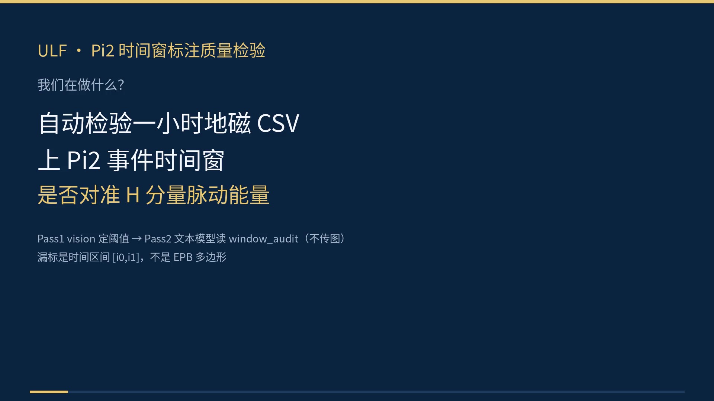

# AI4S Two-Pass ViT Agent

**English** · [简体中文](README_zh.md)

Physics-informed, multi-modal **dataset quality inspection** agent for space-science imagery and magnetometer time series. Combines deterministic metrics with a **two-pass** vision / text LLM workflow, plus an optional **Dataset Router** and **Scientific Debater** extension track.

> **Privacy:** This repository contains **code, docs, and a few downsampled gallery crops only**. No full competition datasets, partner-identifying materials, or credentials.

---

## At a glance

| | |
|---|---|
| **Background** | OPC-style QC on **AIA (solar EUV)**, **EPB (airglow)**, **ULF (magnetometer)**, and extended instrument families (e.g. aurora UV, coronagraph). Pure end-to-end VLMs suffer hallucinations on diffuse targets and 1D waveforms. |
| **Method** | Local **physics / geometry operators** → **Pass 1** perception → script-audited metrics → **Pass 2** grounded verdict (must cite numbers). **Router** profiles unknown dirs; **Debater** drafts `auxiliary_metrics.py` in a sandbox for new families. |
| **Innovations** | Dual-track gate (frozen benchmark IDs → rule-only); gated **Teaching**; tiered **Memory**; AST **code sandbox** for model-written helpers; reproducible Docker + smoke harness. |
| **Results** | Full object-level QC + scoring on official benchmark dirs; **6 instrument families / 30 public subsets — 100% router accuracy** in regression harness; offline Debater E2E on EPB / DMSP / CME samples; `linux/amd64` container. |

---

## Architecture



**Extended track (non-benchmark dirs):** `dataset_router` → optional `scientific_debater` (v0→v1→v2) → env-gated bridge into Pass 1.


---

## Gallery

### Core modalities (rule + two-pass)

| AIA solar EUV | EPB airglow | ULF Pi2 waveform |
|:---:|:---:|:---:|
|  |  |  |

### Extension track (single-frame examples)

| EPB overlay QC | DMSP aurora UV | CME coronagraph | AIA AR (resized) |
|:---:|:---:|:---:|:---:|
|  |  |  |  |

See [docs/gallery/README.md](docs/gallery/README.md).

---

## Demos (short clips)

| Clip | Content |
|------|---------|
| [agent_workflow_demo.mp4](docs/media/agent_workflow_demo.mp4) | End-to-end agent workflow overview |
| [ulf_signal_pipeline_demo.mp4](docs/media/ulf_signal_pipeline_demo.mp4) | ULF band-pass / envelope / Pass 2 text track |

---

## Quick start

```bash
docker build --platform linux/amd64 -f docker/Dockerfile -t space-science-agent:latest .
# Mount your data root at /data and optional secrets.yaml
docker run --rm -v /path/to/data:/data:ro -e ROADSHOW_DATA=/data \
  space-science-agent:latest smoke/smoke_test.py
```

```bash
python3 smoke/check_pipeline_completeness.py
python3 smoke/verify_extended_pipeline.py   # needs ROADSHOW_REPO_ROOT with public sample dirs
python3 agent/run_pipeline.py --dir /path/to/dataset --limit 5 --router auto --debater offline
```

Environment: `ROADSHOW_DATA`, `ROADSHOW_RESULTS`, `AGENT_PIPELINE_ROOT`, optional `secrets.yaml` for Pass 1/2 API.

---

## Repository layout

| Path | Role |
|------|------|
| `package/agent_modules/` | Physics metrics, QC, `dataset_router`, `scientific_debater` |
| `package/scripts/` | Dir/object CSV pipelines, postprocess |
| `agent/` | `run_pipeline.py`, agent YAML |
| `smoke/` | `smoke_test`, `verify_extended_pipeline`, completeness check |
| `docker/` | `linux/amd64` image |
| `docs/` | Defect specs, gallery, media |

---

## Citation & license

Research / competition codebase. If you use this work, cite the repository URL. Dataset terms remain with original OPC / instrument providers—**do not redistribute** roadshow archives via this repo.

---

## Contact

Issues and discussions: [GitHub Issues](https://github.com/Rayana-AD/AI4S-TwoPassViT-Agent/issues).