# AI4S Two-Pass ViT Agent

**简体中文** · [English](README.md)

面向空间科学多模态数据（太阳极紫外成像、电离层气辉掩膜、地磁脉动时序及扩展仪器族）的**物理约束 + 两阶段大模型**质量评价智能体，并可选接入 **Dataset Router** 与 **Scientific Debater** 扩展轨。

> **保密说明：** 本仓库仅公开**源码、文档与少量降采样示意样本**，不含完整竞赛数据集、合作方标识材料或 API 密钥。

---

## 速览

| | |
|---|---|
| **背景** | 官方评测类 OPC 数据质检：AIA / EPB / ULF 等；纯端到端 VLM 在弥散背景与时序波形上易产生幻觉、缺乏可复核数值链。 |
| **方法** | 本地**确定性物理 / 几何算子** → **Pass1** 感知初判 → 脚本审计指标 → **Pass2** 终审（强制引用标量）；新目录经 **Router** 画像分派；**Debater** 在沙箱中迭代 `auxiliary_metrics.py` 衔接主轨。 |
| **创新点** | 12 个基准目录**双轨回退**（规则专用、关闭 Debater）；**门控 Teaching**；**分级 Memory**；模型生成代码 **AST 沙箱**；Docker + 烟测 / 扩展自检门禁。 |
| **结果** | 完成基准目录对象级 QC 与六维评分交付；公开子集路由回归 **6 族 30 目录 100% 命中**；EPB / DMSP / CME 等扩展族离线 Debater 链路可审计；提供 `linux/amd64` 容器镜像构建。 |

---

## 架构示意

### 1）统一入口 `run_pipeline.py`（基准集 vs 扩展轨）

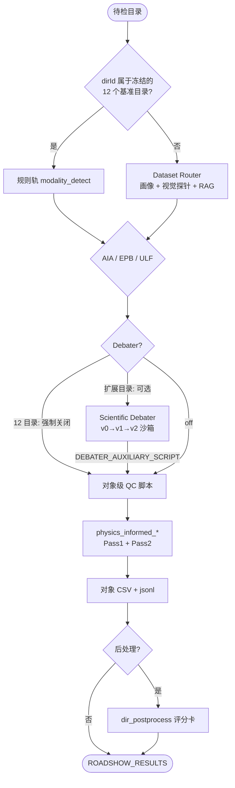

### 2）单样本两阶段（先算后判，Pass2 必须引用数值）

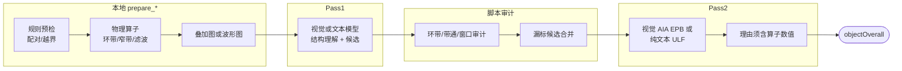

| 模态 | Pass1 | 典型算子 | Pass2 |
|------|-------|----------|-------|
| **AIA** | 日冕 EUV + 标注叠加 | 外向环带对比度 Δ、漏标亮斑候选 | 视觉终审 |
| **EPB** | 气辉 + 掩膜叠加 | 外扩窄带耗空 σ、面积比 | 视觉终审 |
| **ULF** | 滤波波形图（Pass2 **不传图**） | 带通包络、峰噪比、能量窗 | **纯文本**终审 |

### 3）ULF 专用链路（与赛题流程图一致）

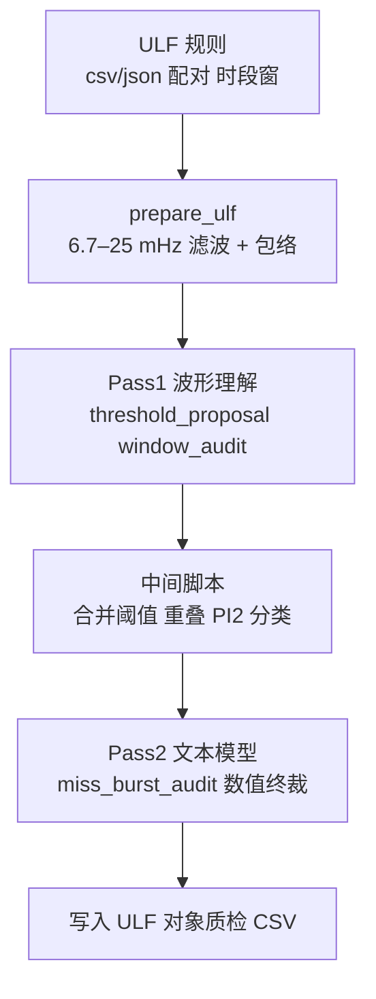

### 4）扩展轨：Debater 衔接主轨（环境变量门控）

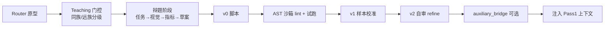

图例：**实线框** = 本地 Python 确定性步骤；**12 基准目录**不走 Debater 注入评分路径。

---

## 与一般「LLM Agent」范式的联系与区别

| 常见范式（CrewAI / ReAct / 工具调用对话） | 本项目 |
|----------------------------------------|--------|
| **ReAct** 开放式循环，模型自选工具直到结束 | **固定 DAG**：规则脚本 → Pass1 → 指标审计 → Pass2；Debater 为**可选侧枝** |
| **多 Agent** 角色群聊协作 | **单编排入口**（`run_pipeline.py`）+ **分阶段辩题**（每阶段固定交付物） |
| 跨会话 **向量长期记忆** | 基准评测 **run 级隔离**；辩题侧 **分阶段裁剪上下文**，防串扰 |
| 模型在文案中**猜数字** | 数字由 **Python 物理算子**产出；Pass2 **强制引用**（ULF Pass2 **纯文本、不传波形图**） |
| **Function Calling** 调 HTTP/数据库 | 「工具」= **批处理 QC 脚本**；扩展轨增加 **沙箱内代码生成** |
| 单轮 Prompt / 纯 CoT 做质检 | **两阶段** + 中间 jsonl + **九类缺陷** CSV 契约 |
| 全链路 LangGraph | `graph.py` 用于记录级规则图；主路展为 **子进程流水线** 以保证可复现 |

**一句话**：更接近 **Agent Harness + 领域工作流**，大模型做**有锚点的终审 / 代码起草**，而非对话即评分。

---

## 安全性与可信（模型 + 代码）

| 层级 | 机制 |
|------|------|
| **防幻觉** | Pass2 须引用标量；ULF 的 **DSP 在本地算完** 再喂文本 Pass2 |
| **基准集防污染** | 冻结 **12 个 dirId** → 纯规则轨，**关闭 Debater**，辅助脚本不进入计分路径 |
| **模型生成代码** | `script_sandbox.py`：AST 白名单 import、禁止 `exec/eval/__import__`、只读 `open`、返回值须 JSON 可序列化 |
| **辅助指标边界** | 仅当设置 `DEBATER_AUXILIARY_SCRIPT` 时桥接；**不替代** `objectOverall` 主轨输出 |
| **教学安全** | `do_not_copy_when` 对远族仪器 **降级提示**，避免跨域照搬深测逻辑 |
| **供应链** | 仓库无密钥；可选挂载 `secrets.yaml`；离线 Debater / 烟测 **无需外网** |
| **回归门禁** | `smoke_test` 指纹 + `verify_extended_pipeline` + `check_pipeline_completeness` |

---

## 可视化 Gallery

### 演示视频关键帧（非封面）

截取自 [`agent_workflow_demo.mp4`](docs/media/agent_workflow_demo.mp4)、[`ulf_signal_pipeline_demo.mp4`](docs/media/ulf_signal_pipeline_demo.mp4)。

| AIA 两阶段界面 | EPB 两阶段界面 | ULF 滤波 / Pass2 轨 |
|:---:|:---:|:---:|
| 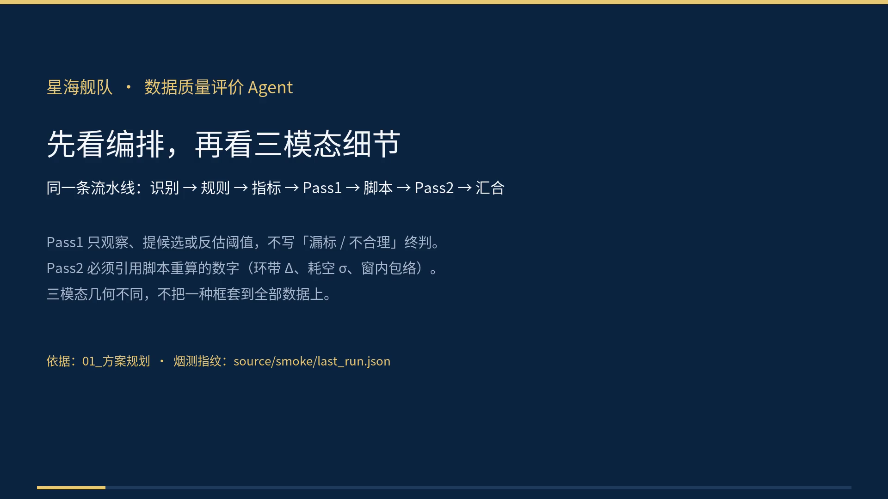 | 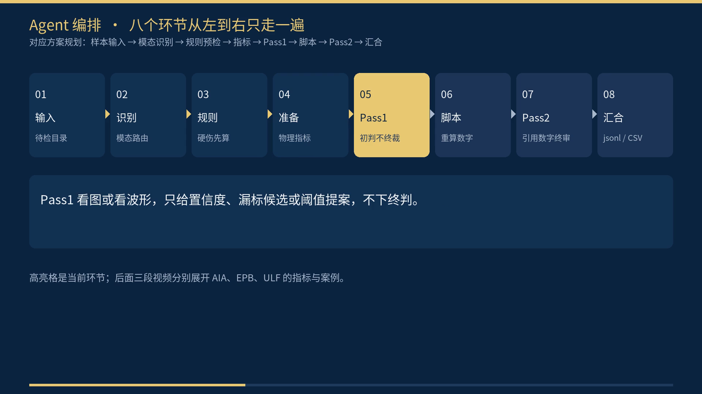 | 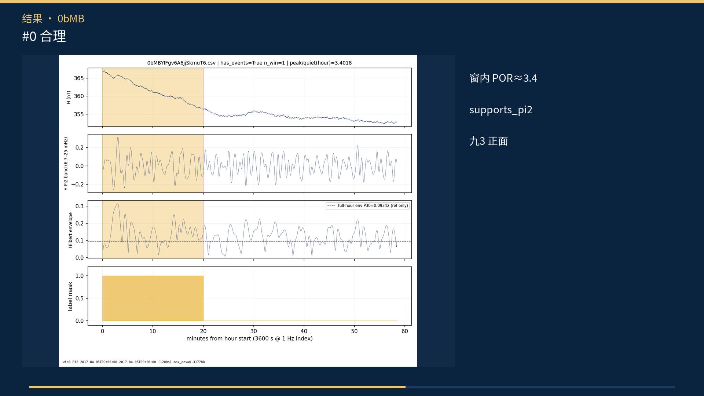 |

### 模态说明海报（仅封面示意）

| AIA 太阳 EUV | EPB 气辉 | ULF 脉动 |
|:---:|:---:|:---:|
| 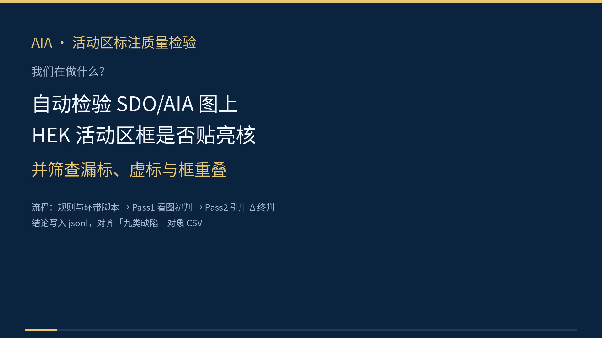 | 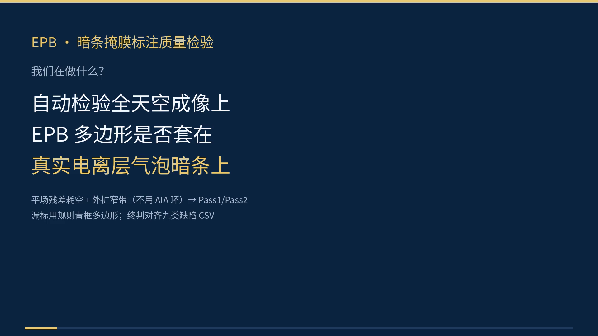 | 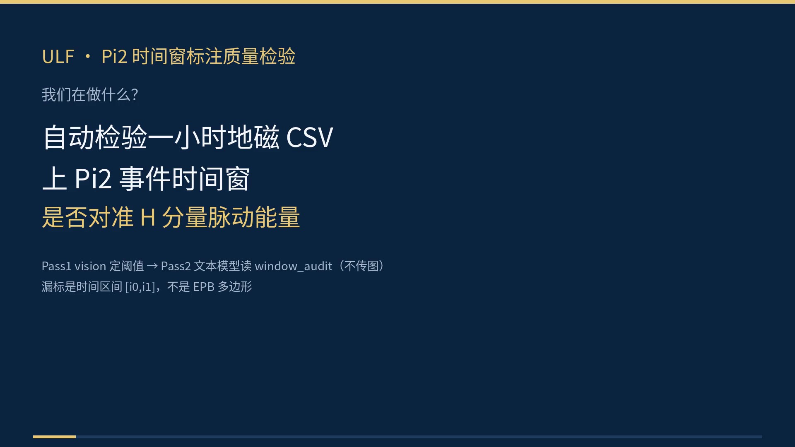 |

### 扩展轨（单帧示意，非整目录）

| EPB 叠加质检 | DMSP 极光 UV | CME 日冕仪 | AIA 活动区（降采样） |
|:---:|:---:|:---:|:---:|
| 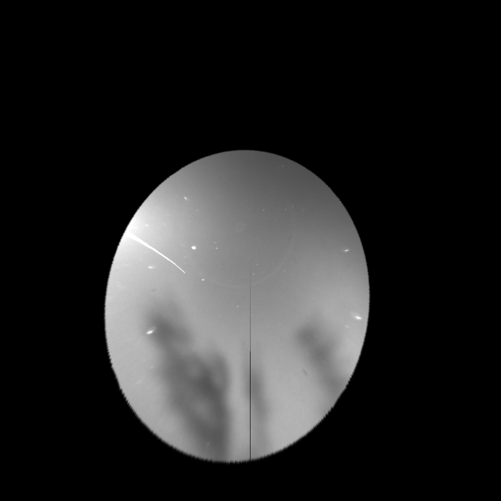 | 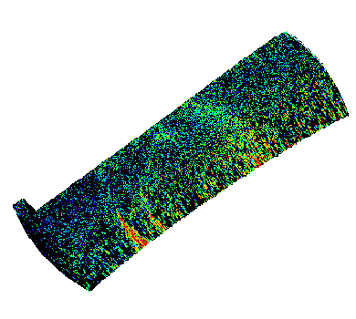 | 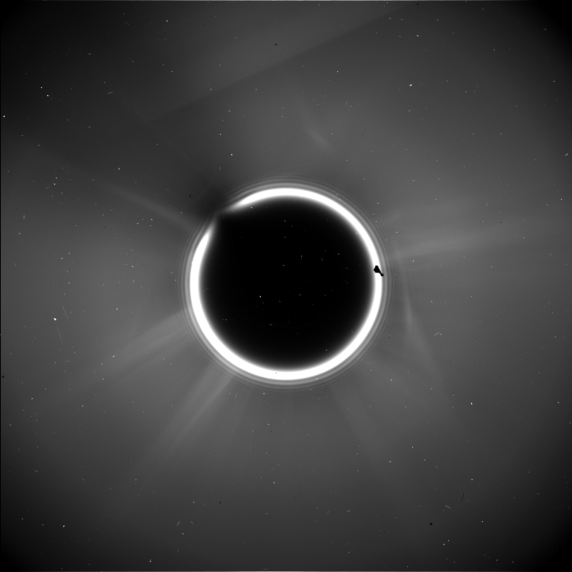 | 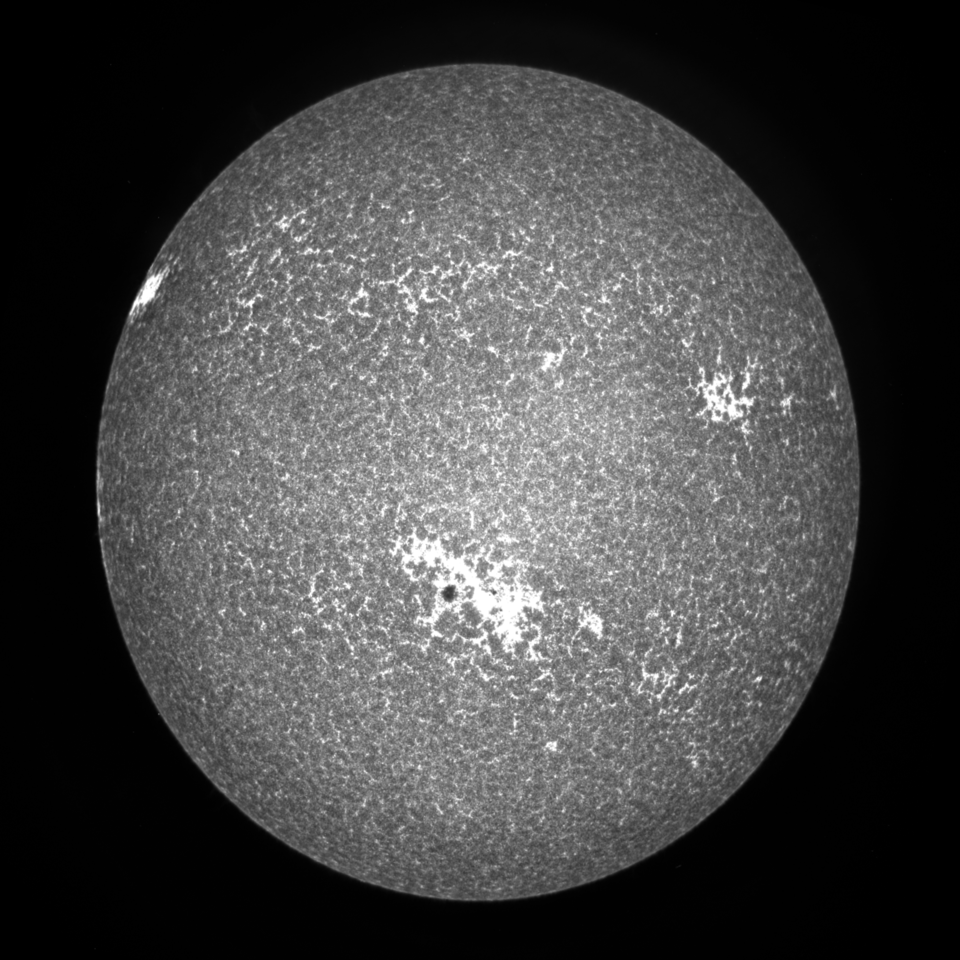 |

详见 [docs/gallery/README.md](docs/gallery/README.md)。

---

## 短视频示意

| 文件 | 内容 |
|------|------|
| [agent_workflow_demo.mp4](docs/media/agent_workflow_demo.mp4) | 智能体端到端工作流概览 |
| [ulf_signal_pipeline_demo.mp4](docs/media/ulf_signal_pipeline_demo.mp4) | ULF 带通 / 包络与文本终审轨 |

---

## 快速开始

```bash
docker build --platform linux/amd64 -f docker/Dockerfile -t space-science-agent:latest .
docker run --rm -v /path/to/data:/data:ro -e ROADSHOW_DATA=/data \
  space-science-agent:latest smoke/smoke_test.py
```

```bash
python3 smoke/check_pipeline_completeness.py
python3 smoke/verify_extended_pipeline.py
python3 agent/run_pipeline.py --dir /path/to/dataset --limit 5 --router auto --debater offline
```

环境变量：`ROADSHOW_DATA`、`ROADSHOW_RESULTS`、`AGENT_PIPELINE_ROOT`；Pass1/Pass2 在线重跑需自备 `secrets.yaml`。

---

## 目录结构

| 路径 | 说明 |
|------|------|
| `package/agent_modules/` | 物理指标、QC、Router、Debater |
| `package/scripts/` | 目录 / 对象 CSV 流水线 |
| `agent/` | `run_pipeline.py` 与智能体声明 |
| `smoke/` | 烟测与扩展自检 |
| `docker/` | amd64 镜像 |
| `docs/` | 九类缺陷说明、Gallery、演示媒体 |

---

## 数据与引用

完整路演数据请通过赛方 / 数据提供方正规渠道获取，**禁止**通过本仓库传播原始数据包。使用代码请注明本仓库地址。

问题反馈：[GitHub Issues](https://github.com/Rayana-AD/AI4S-TwoPassViT-Agent/issues)。